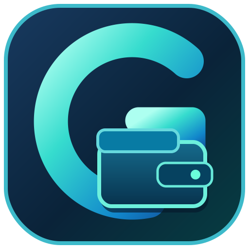

<div align="center">



# GlassBalance

**Your money. Your computer. Your control.**

An open-source, offline-first personal finance desktop application for **Windows and Linux**.

[](https://github.com/Onimee58/GlassBalance/releases)
[](LICENSE)
[](https://github.com/Onimee58/GlassBalance/releases)
[](https://github.com/Onimee58/GlassBalance/actions)

[**Download**](https://github.com/Onimee58/GlassBalance/releases) · [**Report an issue**](https://github.com/Onimee58/GlassBalance/issues) · [**Source code**](https://github.com/Onimee58/GlassBalance)

</div>

> [!IMPORTANT]
> **Early alpha software.** GlassBalance is under active development. Back up your ledger before upgrading. The current Windows executable is unsigned, so Windows SmartScreen may display an **Unknown publisher** warning. Always obtain builds from the official GitHub Releases page.

## What is GlassBalance?

GlassBalance began as a way to replace a personal Excel balance sheet with a clean, native desktop application. It keeps the familiar idea of a **continuous running balance**: money received increases your balance; money spent decreases it. Your records stay in a local SQLite database and the app works without an account or constant internet connection.

GlassBalance is written with **Python and PySide6 (Qt)**. It is **not** a web app or Electron wrapper.

## Features

| Feature | Description |
| --- | --- |
| **Continuous ledger** | Add, edit, and delete dated income and expenses; running balances update automatically. |
| **Balance Search** | Search descriptions such as `ammu` and see matching entries, money in, money out, and net total. |
| **Unbalanced** | Track money lent or borrowed and outstanding amounts. |
| **Repayment review** | Suggest possible repayments from names and keywords like `refund`; **every link requires confirmation**. |
| **Partial repayments** | Link or unlink repayments without changing the underlying ledger totals. |
| **Monthly history** | Review monthly income, expenses, and closing balances. |
| **Balance chart** | See a recent running-balance trend. |
| **Excel / CSV import** | Import the original multi-section balance workbook or a curated transaction file. |
| **Export and backups** | Export records and create/restore full local database backups. |
| **Optional encrypted email snapshots** | Manually send or restore an encrypted backup through compatible SMTP/IMAP email accounts. |
| **Offline-first** | Finance data stays on your computer unless you choose to export or back it up elsewhere. |

### What's new in v0.2.0-alpha.3?

- Introduced the official **G + Wallet** application icon and branding.
- Fixed the Windows sidebar appearing white in the dark interface.
- Improved cross-platform styling and asset bundling.
- Preserved the **Balance Search** and **Unbalanced** features introduced in alpha.2.
- Continued support for the maintainer avatar in the **About** dialog, including a local-photo option.

For full history, see [Releases](https://github.com/Onimee58/GlassBalance/releases) and [CHANGELOG.md](CHANGELOG.md).

## Download and run

Get the latest release from **[GitHub Releases](https://github.com/Onimee58/GlassBalance/releases)**. Releases are currently marked **pre-release** while GlassBalance is being tested.

### Windows

1. Download the **Windows x64** ZIP from the release assets.
2. Extract the ZIP completely. **Keep the executable and its accompanying files together.**
3. Open `GlassBalance.exe`.
4. On first launch, import a spreadsheet or start with an empty ledger.

**SmartScreen notice:** Windows may show *“Windows protected your PC”* because the executable is currently unsigned and has limited publisher reputation. This is not by itself a malware finding. Do not disable Windows security protections globally; check that you downloaded the archive from this repository's official release and only run software you trust.

### Linux

1. Download the **Linux x86_64** ZIP from the release assets.
2. Extract the ZIP completely, keeping its contents together.
3. Make the executable runnable if needed and launch it:

```bash
chmod +x GlassBalance
./GlassBalance
```

The standalone build bundles Python dependencies. Some Linux distributions may still require compatible system desktop libraries.

**Known limitation:** On some GNOME/Ubuntu desktops, launching the extracted executable directly shows a generic gear icon in the dock. A desktop launcher/integration fix is planned; this does not affect the ledger.

### Run from source

Requires **Python 3.11+**. The launcher creates a virtual environment and installs the needed dependencies on its first run.

**Linux:**

```bash
git clone https://github.com/Onimee58/GlassBalance.git
cd GlassBalance
chmod +x run-linux.sh
./run-linux.sh
```

**Windows:** Clone or download the source code, then double-click `run-windows.bat`.

> The first source launch needs internet access to install dependencies. Normal ledger use after installation does not require a network connection.

## How the ledger works

Each transaction has a description, signed amount, and date:

| Description | Signed amount | Effect |
| --- | ---: | --- |
| Salary | +2,000.00 | Balance increases |
| Rent | -800.00 | Balance decreases |
| Refund | +20.00 | Balance increases |

Your **opening balance is separate from income**. Changing a historical transaction recalculates later running balances. The app preserves additional precision needed by some imported historical records.

### Balance Search vs. Unbalanced

**Balance Search** adds up transactions matching a search phrase. It does **not** determine whether a person owes you money.

**Unbalanced** tracks specific lending or borrowing relationships. For example, lending someone 500 and linking a confirmed repayment of 200 leaves **300 outstanding**. The app may suggest a match, but **never automatically settles or links a repayment**. Confirming or unlinking a repayment does not add a second income/expense entry or otherwise change your main ledger balance.

## Importing Excel history

Select **Import Excel / CSV** and choose either an original horizontally arranged balance workbook or a curated `.xlsx` / `.csv` ledger.

If historical transactions lack dates, the importer estimates them using the known salary cycle: a salary labeled **August Salary** is dated **August 31**, the following month's rent is dated **September 2**, and other transactions are spread through the following period. **Estimated dates are marked as estimated**, not presented as facts. Source identifiers help avoid duplicating an import.

**Tip:** Make a backup before importing or restructuring your history. Reimporting corrected source rows may skip already-imported entries rather than overwrite your manual edits.

## Data, privacy, and backups

- Financial data is stored locally in **`balance.sqlite`** using your operating system's application-data location (commonly under `%LOCALAPPDATA%` / `%APPDATA%` on Windows or `~/.local/share/GlassBalance/` on Linux).
- Local database files are **not encrypted at rest by default**. Use OS disk encryption if that protection is important to you.
- Full local database backup/restore is available inside the application.
- Optional email backup uses encrypted snapshots, **not** automatic multi-device synchronization. Restoring a snapshot can replace newer local changes; review the warning and keep a safety backup.
- Never commit personal `.xlsx`, `.csv`, `.sqlite`, `.db`, password, or backup files to the public repository.

## Development

GlassBalance uses Python 3.11+, PySide6/Qt 6, SQLite, `openpyxl`, and `cryptography`.

Run the core tests:

```bash
python -m pip install -r requirements-dev.txt
python -m unittest discover -s tests -v
```

CI builds Windows and Linux application bundles using [GitHub Actions](.github/workflows/build.yml). Passing CI checks means the automated jobs completed; it is **not a substitute for testing the resulting desktop application**.

### Planned improvements

- Better Linux desktop launcher and dock-icon integration.
- Description autocomplete, optional transaction categories, and undo deletion.
- Theme options, accessibility and layout refinements.
- Improved import review, backup safeguards, and financial insights.
- Installer/signing improvements and conflict-aware encrypted device synchronization.

These are plans, not features already included in the current release.

## Contributing

Suggestions, bug reports, documentation updates, and pull requests are welcome. Please open an [issue](https://github.com/Onimee58/GlassBalance/issues) describing the problem or proposal before tackling a substantial change. **Do not attach real financial records** to public issues or pull requests; use anonymized sample transactions.

For development, create a `feature/...` or `fix/...` branch from `main`, run the tests, and submit a pull request back to `main`. Releases are identified by version tags.

## Creator and license

**Created and maintained by [@Onimee58](https://github.com/Onimee58)** · Project started October 2026.

GlassBalance application source is released under the **[MIT License](LICENSE)**. Third-party dependencies retain their own licenses; redistribution must comply with applicable Qt and other dependency terms.

---

<div align="center"><sub>GlassBalance · Open source · Offline first · Built for Windows and Linux</sub></div>
